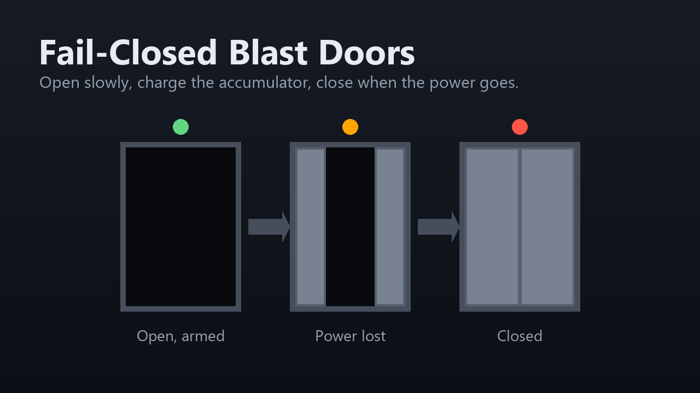

# Fail-Closed Blast Doors

A [StationeersLaunchPad](https://github.com/StationeersLaunchPad/StationeersLaunchPad) plugin
mod. A blast door closes by itself when it loses power, using a hydraulic accumulator that
opening the door charges. A blast door is for containment, not traffic: it opens slowly.



Only `StructureBlastDoor` is changed. Airlocks, hangar doors and every other door, including
modded ones that share the `Airlock` component, keep their vanilla behaviour. Other mods can
[register their own blast door prefabs](#for-modders).

## How it works

The accumulator holds stored energy `c` from 0 (empty) to 1 (full). A door open by a fraction
`t` needs `t` of it to get back to closed, so **a door can close if `c >= t`**.

- **Powered open takes 10 seconds** (configurable) and charges the accumulator as it goes, so
  `c` follows `t`: a fully open door is armed, and a partly open one has enough to close.
- **Every close takes the vanilla time** and spends stored energy. A closed door is empty.
- **Power loss closes an open door** if `c >= t`.
- **A crowbar open while unpowered** runs at vanilla speed and does not charge the
  accumulator: the manual move diverts the hydraulics. The door then stays open on power loss
  until it has recharged.
- **Recharging.** A powered, fully open door refills at the same rate as a powered open
  (10 seconds from empty). The status lights show a different colour while it does.
- **A close the accumulator cannot cover is refused.** Blast doors have no keypad, so this is
  about logic: writing `Open = 0` to a door with `c < t` sets the door's `Setting` to 0 (its
  desired state) and its `Error` logic value to 1. When the accumulator catches up, the
  door closes and `Error` clears. Opening, or a crowbar open or close, resets `Setting` and
  cancels the request. Writing `Setting = 0` to an open door asks for the same close.
- The crowbar path is not gated: a manual close always works.

## Limits worth knowing

- **Multiplayer.** The accumulator lives on the host. Clients see the slow open (the animation
  patch runs everywhere) but not the recharge colour, and `Error` and `Setting` reach them
  through the game's own sync.
- **Saves.** The charge is not saved. On load an open, powered door counts as armed and an
  open, unpowered one as empty. Vanilla saves `Setting = 0` for open doors, so the mod sets
  `Setting` to match each door's state on load; a pending close does not survive a reload.
- **Status light.** Only the lights change colour. The emissive panel's material changer only
  knows vanilla's colours and shows its plain "powered" look.
- **Close hazards.** The close is as fast as vanilla and the door has no obstruction check of
  its own, so anything in the doorway when power drops is caught by the closing colliders.

## Configuration

`BepInEx/config/fail-closed-blast-doors.cfg`, created on first run:

| Setting | Default | |
|---|---|---|
| `OpenSeconds` | `10` | Powered open time and recharge time from empty. |
| `RechargeColor` | amber | Status light colour while recharging. |

## For modders

`FailClosedBlastDoors.BlastDoorApi` is static and its readers are safe from any thread (the
state is cached each frame).

```csharp
BlastDoorApi.Register("MyModdedBlastDoor");        // apply the behaviour to another prefab
BlastDoorApi.GetState(door);                       // BlastDoorState
BlastDoorApi.GetCharge(door);                      // 0..1
BlastDoorApi.GetOpenFraction(door);                // 0..1
BlastDoorApi.StateChanged += (door, from, to) => { };   // main thread, host only
```

| `BlastDoorState` | Meaning |
|---|---|
| `NotBlastDoor` | Not a registered prefab. |
| `Standby` | Not moving or recharging, or moved without power. |
| `Opening` | Opening under power: the motor runs and the accumulator charges. |
| `Recharging` | Open and powered with the accumulator not full. |
| `Closing` | Closing: hydraulic release, no motor load. |

A registered prefab must be a `Door` whose animation is a `BinaryAnimComponent`, as the blast
door's is. The mod never changes a door's power draw: it stays the vanilla constant while on,
and a mod that varies it per state does so from this API. To depend on this mod without
requiring it, soft-depend on its plugin ID, `fail-closed-blast-doors`.

## Building

Needs the .NET SDK and a Stationeers install.

```
dotnet build Main.csproj
dotnet build Main.csproj -t:Install
```
